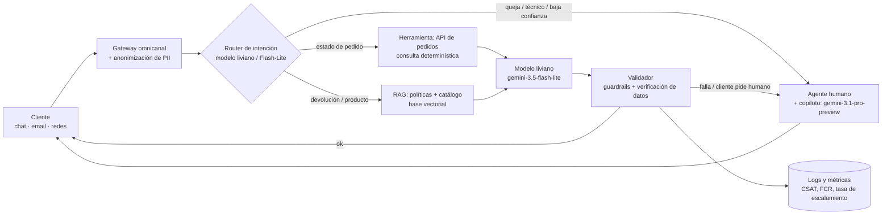

# Fase 1: Selección y justificación del modelo

**Caso:** EcoMarket · optimización de la atención al cliente con IA generativa

## 0. Criterios y suposiciones

Estas son mis decisiones de partida como autor del taller. El resto del documento las argumenta;
declararlas aquí permite juzgar la propuesta sabiendo desde dónde se construyó.

- Prefiero desarrollar rápido un prototipo que permita evaluar y validar una solución base, usando
  modelos de proveedores comerciales como Gemini o Claude. Las consideraciones de infraestructura
  propia, local o en la nube, las dejo para una etapa posterior de optimización.
- Elijo dos proveedores, Gemini y Claude, por familiaridad y facilidad de integración.
- Un modelo liviano como enrutador es suficiente para clasificar el tipo de consulta, por ejemplo
  `gemini-3.1-flash-lite` o `claude-haiku-4-5`.
- Un modelo intermedio como `gemini-3.5-flash-lite` o `claude-sonnet-5` puede bastar para procesar
  las solicitudes que impliquen validar datos y redactar una respuesta.
- Los modelos mencionados, apoyados en RAG, tienen desempeño y ventana de contexto suficientes para
  operar sin fine-tuning, al menos en una primera etapa de evaluación de la propuesta.
- Asumo un volumen de 5.000 consultas diarias, 150.000 al mes, para dimensionar el costo, repartidas
  según el 80/20 del enunciado.
- Asumo que el 20% complejo mantiene siempre a una persona en el circuito: el modelo asiste al
  agente humano y no decide por él.
- Uso el tier gratuito de los proveedores únicamente porque todos los datos del taller son
  sintéticos. En producción haría falta el tier de pago con un acuerdo de tratamiento de datos.

Los identificadores exactos de modelo viven en `providers.toml`, no en este documento ni en el
código; aquí se nombran en su forma corta por legibilidad.

---

## 1. Requisitos del caso

Antes de nombrar un modelo hay que decir qué tiene que resolver. Cada hecho del enunciado genera un
requisito técnico, y es contra esos requisitos que se justifica la elección.

| Hecho del caso | Requisito que genera |
|---|---|
| Miles de consultas diarias por chat, correo y redes sociales | Alta concurrencia, baja latencia y **costo por consulta bajo**; un solo motor para varios canales |
| El 80% son repetitivas: estado de pedido, devoluciones, características del producto | **Precisión factual** sobre datos vivos. El modelo no debe "saber" un estado de pedido: debe **consultarlo** |
| El 20% son complejas: quejas, problemas técnicos, sugerencias | Empatía, razonamiento y **escalamiento a un humano**; el modelo apoya al agente, no lo reemplaza |
| El tiempo de respuesta actual llega a 24 horas | Respuesta inmediata en el 80% y borrador asistido en minutos para el 20% |
| La empresa crece rápido | Escalabilidad elástica **sin reentrenar** cuando cambian el catálogo o las políticas |
| La marca se basa en productos sostenibles | Tono coherente con la marca y cero respuestas inventadas: la confianza es el activo |

Dos requisitos mandan sobre el resto. El primero es que **la mayor parte del trabajo es de consulta,
no de generación**: el cliente que pregunta por el pedido ECO-1005 quiere un dato, no una redacción
creativa. El segundo es que **los datos cambian todos los días**: pedidos, inventario y políticas se
mueven constantemente. Ambos empujan hacia la misma conclusión arquitectónica, que se desarrolla en
la sección 2.

## 2. Solución propuesta: arquitectura híbrida

El sistema propuesto consiste en el uso de modelos y controles alrededor:

Cada componente responde a un requisito concreto:

1. **Router de intención.** Un clasificador muy barato separa el 80% del 20% y decide qué
   herramienta usar. Evita pagar el modelo robusto en consultas triviales; es la pieza que hace que
   el costo total sea sostenible.
2. **Tool calling contra la base de pedidos.** El estado de un pedido es un **dato**, no
   conocimiento. Se consulta de forma determinística y el LLM solo redacta con el resultado a la
   vista. Esta es la mitigación principal de las alucinaciones, y la que se demuestra en la Fase 3.
3. **RAG sobre políticas y catálogo.** El catálogo y las políticas cambian con frecuencia; con
   recuperación se actualizan sin reentrenar nada. El fine-tuning no sirve para datos que cambian.
4. **Modelo liviano** para el volumen: menor latencia y costo, y calidad suficiente cuando el
   contexto viene dado. Cuando el modelo no tiene que recordar, un modelo pequeño basta.
5. **Modelo robusto como copiloto del agente humano** en el 20% complejo: resume el caso, propone un
   borrador empático y sugiere una solución. El humano decide y firma.
6. **Validador y guardrails.** Comprueba que los números de pedido, las fechas y los enlaces de la
   respuesta existan de verdad en los datos consultados; bloquea las promesas fuera de política y
   deriva a un humano si detecta frustración.
7. **Observabilidad.** Métricas de negocio (CSAT, tiempo de primera respuesta, tasa de resolución en
   el primer contacto, tasa de escalamiento) y de calidad (tasa de alucinación medida por auditoría
   por muestreo).

La Fase 3 de este taller implementa una versión en miniatura de los componentes 2, 4 y 6: búsqueda
determinística en JSON, redacción con un modelo liviano y validación en código de la respuesta.

## 3. Modelos seleccionados

La elección es una **familia de modelos con dos tamaños**, no un modelo único, porque los dos
segmentos del tráfico tienen necesidades opuestas: volumen barato frente a razonamiento fino.

| Rol | Opción principal (Google) | Alternativa comercial (Anthropic) | Por qué ese tamaño |
|---|---|---|---|
| Router de intención | `gemini-3.1-flash-lite` | `claude-haiku-4-5` | Clasificar entre cinco intenciones no necesita un modelo grande |
| Motor del 80% repetitivo | `gemini-3.5-flash-lite` | `claude-sonnet-5` | Con el contexto ya recuperado, la tarea es redactar, no razonar; un modelo con razonamiento sería gasto inútil |
| Copiloto del 20% complejo | `gemini-3.1-pro-preview` | `claude-opus-5-5` | Quejas y problemas técnicos exigen razonamiento y matiz de tono |

Se elige **Gemini como opción principal** por tres razones concretas del proyecto: tiene un tier
gratuito que permite iterar desde el primer día, expone una **API compatible con la de OpenAI** (lo
que reduce el acoplamiento, como se explica abajo), y su modelo liviano tiene una relación
costo-latencia adecuada para miles de consultas diarias. Anthropic queda documentado como
alternativa de calidad equivalente, y en el código basta cambiar un perfil de configuración para
usarlo.

**Por qué Flash-Lite y no Flash para el motor del 80%.** La elección inicial fue `gemini-3.8-flash`,
el modelo intermedio de la familia. Al ejecutar la Fase 3 contra la API aparecieron dos límites que
la descartaron:

- Su **tier gratuito permite 20 peticiones al día**, insuficiente para iterar sobre una suite de
  evaluación, y muy lejos de las 5.000 consultas diarias del caso.
- Es un **modelo con razonamiento**: consume el presupuesto de `max_tokens` pensando antes de
  responder, así que con un presupuesto ajustado devuelve una respuesta vacía. Para redactar sobre un
  contexto ya recuperado, ese razonamiento no aporta y sí se paga.

`gemini-3.5-flash-lite` responde en menos de un segundo, no gasta tokens en razonamiento y su cuota
gratuita permite ejecutar la matriz completa. Es el modelo con el que se produjo la evidencia de la
Fase 3 y el que se recomienda para el 80% repetitivo. El escenario con Flash se conserva en la tabla
de costos de §6.1 como comparación.

Este episodio ilustra algo que ninguna hoja de especificaciones anticipa: **la cuota y el
comportamiento real del modelo pesan tanto como su calidad nominal**, y solo se conocen ejecutando.
Es un argumento más para la capa de abstracción de proveedores.

**Los IDs de modelo no están en el código.** Viven en un único archivo `providers.toml`, y el código
pide "el modelo liviano" o "el modelo robusto", no un ID concreto. Esta decisión es deliberada: los
proveedores retiran y renombran versiones con frecuencia, y una migración debe costar una línea de
configuración, no una refactorización.

## 4. ¿Modelo de propósito general o afinado?

**Propósito general, con RAG y herramientas, sin fine-tuning en la versión 1.** Los argumentos:

- **Los datos críticos cambian a diario.** Pedidos, inventario y políticas se mueven cada día, y el
  fine-tuning congela conocimiento en los pesos. Un modelo afinado con el catálogo de septiembre
  responde con el catálogo de septiembre en diciembre. RAG no tiene ese problema.
- **El tono y el formato se logran con prompting.** Rol, ejemplos *few-shot* y reglas explícitas
  producen la voz de marca, y se iteran en horas. La Fase 3 lo demuestra midiendo la diferencia
  entre un prompt básico y uno con esas técnicas.
- **No hay datos curados.** El fine-tuning exige conversaciones etiquetadas, consistentes y limpias
  de PII, que EcoMarket todavía no tiene. Afinar con datos sucios reproduce y amplifica los errores
  y sesgos históricos del equipo.
- **El costo de equivocarse es distinto.** Cambiar un prompt es gratis; reentrenar un modelo, no.

**Evolución futura.** Cuando existan miles de conversaciones resueltas y anonimizadas, tiene sentido
evaluar un SLM afinado para el router o para el 80% repetitivo, y reducir así costo y latencia. Esa
es la alternativa C de la sección siguiente, y el diseño actual no la cierra.

## 5. Comparación de alternativas

| Criterio | **A. Híbrida con modelos de frontera (elegida)** | B. Open-source autoalojado + RAG | C. SLM afinado + LLM |
|---|---|---|---|
| Arquitectura | Router + modelo liviano con RAG y herramientas + modelo robusto como copiloto | Llama / Qwen / gpt-oss en GPU propias o nube privada | SLM (1–8B) afinado para lo repetitivo + LLM para lo complejo |
| Calidad de respuesta | Muy alta; buen español; tool calling maduro | Buena a muy buena según el tamaño; exige más ajuste de prompts | Muy buena en tareas estrechas; frágil fuera de su distribución |
| Tiempo al primer piloto | **Días** | Semanas (infraestructura, MLOps) | Semanas a meses (datos, entrenamiento, evaluación) |
| Costo | Variable por token, sin inversión inicial | Costo fijo alto (GPU y equipo); barato a gran escala | Costo de entrenamiento; inferencia muy barata |
| Escalabilidad | Elástica, gestionada por el proveedor | La gestiona EcoMarket | Buena por el tamaño del modelo |
| Integración | SDK y APIs compatibles con OpenAI; function calling nativo | APIs compatibles (vLLM, Ollama), con más piezas propias | Pipeline de datos y reentrenamiento continuo |
| Privacidad | Depende del contrato: tier de pago, DPA y región | **Máxima**: los datos no salen de la empresa | Alta si se autoaloja |
| Dependencia del proveedor | Media; se mitiga con la capa de abstracción | Baja | Baja a media |
| Cuándo conviene | Validar valor rápido y crecer | Volumen muy alto o regulación estricta | Tareas estables con muchos datos históricos |

**Conclusión.** La alternativa A es la mejor opción *hoy* por tiempo al valor, calidad e integración.
Lo importante es que la decisión no es irreversible: la capa de abstracción de proveedores permite
**migrar a B** —la Fase 3 de este taller comprueba que las mismas cadenas corren sin cambios contra
otra familia de modelos— si crecen el volumen o las exigencias de privacidad, y **evolucionar hacia C**
cuando existan datos curados. Elegir A no cierra ninguna puerta; empezar por B o C sí retrasa el
aprendizaje varios meses.
